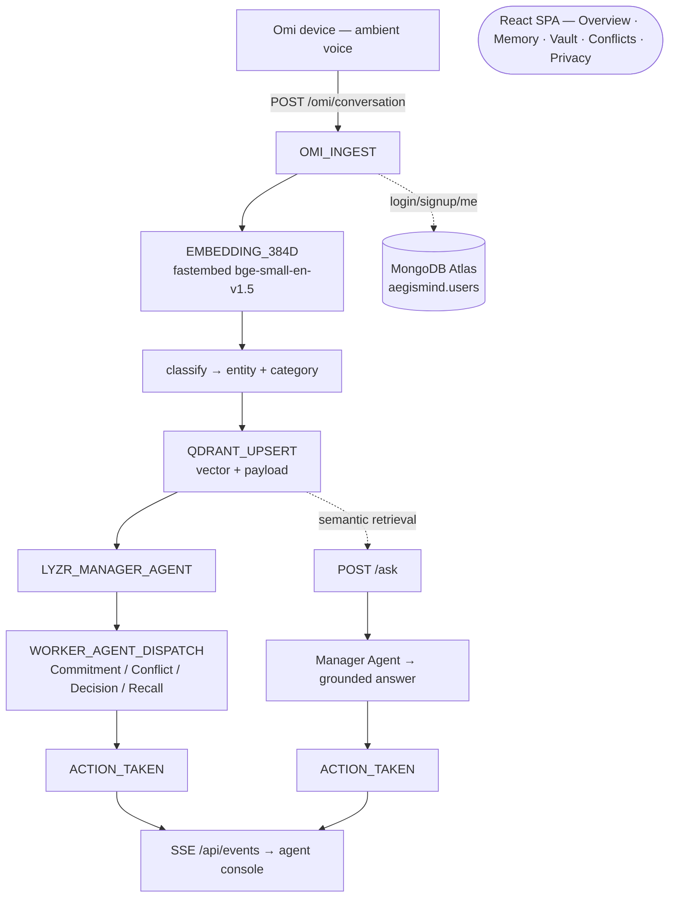

# AegisMind — Autonomous Ambient Chief of Staff

Voice-first, memory-backed agentic assistant. AegisMind listens through **Omi**, persists every signal into a **Qdrant** vector vault, and reasons over it with a **Lyzr** Manager Agent — commitments tracked, conflicts surfaced, anything recalled in plain language.

Built for the *Dawn of the Autonomous AI Builder* hackathon (Lyzr × Qdrant × Omi).

**Build track: Privacy-First Knowledge Systems**

(Meeting-style action-item extraction is a feature of the same loop, not a second track.)

## Architecture

```
                    ┌─────────────────────────────┐
                    │         Omi device          │
                    │  ambient conversation audio │
                    └──────────────┬──────────────┘
                                   │ /omi/conversation, /omi/realtime
                                   ▼
                 ┌─────────────────────────────────┐
                 │   FastAPI backend (app.py)      │
                 │                                 │
                 │  OMI_INGEST ─► EMBEDDING_384D   │
                 │      │            │             │
                 │      │            ▼             │
                 │      │   classify (entity/cat)  │
                 │      │            │             │
                 │      ▼            ▼             │
                 │   ┌───────────┐  QDRANT_UPSERT  │
                 │   │  Mongo DB │        │        │
                 │   │  users    │        ▼        │
                 │   │  accounts │  LYZR_MANAGER   │
                 │   └───────────┘        │        │
                 │                        ▼        │
                 │              WORKER_AGENT_      │
                 │              DISPATCH           │
                 │                        │        │
                 │                        ▼        │
                 │                   ACTION_TAKEN  │
                 └───────────┬────┬─────┬─────┬────┘
                             │    │     │     │
                    /api/events (SSE)   │    POST /ask (semantic recall)
                             │    │     │
                 ┌───────────▼────▼─────▼─────▼────┐
                 │  React SPA (Vite + Tailwind)    │
                 │  Overview · Memory · Commitments │
                 │  Conflicts · Activity · Privacy  │
                 └──────────────────────────────────┘
```



### Mandatory integration

| Requirement | Where |
|---|---|
| Real-time voice input | `POST /omi/conversation`, `POST /omi/realtime` — 200 immediately, pipeline runs async |
| Persistent vector memory | Qdrant, 384-dim cosine (bge-small-en), memory vault `GET /api/memory` |
| Orchestrated agent reasoning | Lyzr Manager Agent → worker dispatch; grounded local fallback without keys |
| Unified execution loop | `OMI_INGEST → EMBEDDING → QDRANT_UPSERT → LYZR_MANAGER → WORKER_DISPATCH → ACTION` — observable live via SSE |

### Privacy-first (track fit)

- Every memory is scoped to its account (`uid` filter on every query).
- **Selective Amnesia**: `POST /api/forget` purges vectors for any entity.
- Sessions are HTTP-only HMAC cookies; passwords PBKDF2 (200k iters) hashed; user accounts in MongoDB Atlas, never vector-stored.

## Local run

```bash
pip install -r requirements.txt
npm install --prefix frontend && npm run build --prefix frontend
copy .env.example .env     # set LYZR_API_KEY + LYZR_AGENT_ID (required for live Lyzr)
docker compose up -d       # optional Qdrant on :6333; otherwise embedded ./qdrant_data
uvicorn backend.app:app --reload --port 8000
python lyzr_test.py        # confirm Studio keys
```

Open http://localhost:8000 — sign up, then simulate a voice segment from the Overview panel to watch the full pipeline stream in.

Frontend dev (hot reload): `npm run dev --prefix frontend` (proxies `/api` and `/omi` to :8000).

### Omi webhooks (real device / phone mic)

Omi cannot reach `localhost`. Expose the backend, then paste the HTTPS URLs into Omi Developer Mode:

```bash
ngrok http 8000
```

| Omi setting | URL |
|---|---|
| Memory creation webhook | `https://YOUR-TUNNEL/omi/conversation` |
| Real-time transcript webhook | `https://YOUR-TUNNEL/omi/realtime` |
| Setup completed (optional) | `https://YOUR-TUNNEL/omi/setup-completed` |

The endpoints answer `200 OK` immediately and run embedding + Qdrant + Lyzr in the background. Capture a sample payload on [webhook.site](https://webhook.site) first if a field name differs. The `uid` query param from Omi is stored on every Qdrant point and used to filter retrieval.

To close the loop, set `OMI_APP_ID` and `OMI_APP_SECRET` so agent actions are pushed back to the wearer via Omi's notifications API.

## API

| Route | Purpose |
|---|---|
| `POST /auth/signup` · `POST /auth/login` · `GET /auth/me` | Accounts (MongoDB Atlas users) |
| `GET /health` | Liveness (public, for deploys) |
| `POST /omi/conversation?uid=…` | Omi conversation webhook (voice → memory) |
| `POST /omi/realtime?uid=…&session_id=…` | Omi realtime webhook (list or `{segments}` body) |
| `GET /omi/setup-completed` | Omi integration “setup complete” probe |
| `GET /api/events` | SSE stream of agent workflow events |
| `GET /api/logs` | Polling fallback for events |
| `GET /api/status` | Omi / Qdrant / Lyzr status |
| `GET /api/memory?uid=…` | Memory vault points (uid-scoped) |
| `POST /ask` | Grounded query over Qdrant via Lyzr Manager Agent |
| `POST /api/forget` | Selective Amnesia — deletes by `{uid, entity}` |

## Environment (`.env`)

- `MONGODB_URI` — **required**. MongoDB Atlas connection string for user accounts.
- `LYZR_API_KEY`, `LYZR_AGENT_ID` — Lyzr Manager Agent. Missing keys fall back to a grounded local manager so the demo still works.
- `LYZR_COMMITMENT_AGENT_ID`, `LYZR_CONFLICT_AGENT_ID`, `LYZR_DECISION_AGENT_ID`, `LYZR_RECALL_AGENT_ID` — optional dedicated worker agents (default to the manager id).
- `OMI_APP_ID`, `OMI_APP_SECRET` — optional; push results back to the Omi app.
- `QDRANT_URL` — defaults to `http://localhost:6333`; if unreachable the backend switches to embedded storage at `QDRANT_PATH` (`./qdrant_data`).

Embeddings: `fastembed` / `BAAI/bge-small-en-v1.5`, 384 dims (model downloads on first boot).

## Deploy (Render / Railway)

`render.yaml` is included — create a Blueprint from the repo, add `MONGODB_URI`, `LYZR_API_KEY` and `LYZR_AGENT_ID` as secrets. Railway works with the same build/start commands.

## Official loop test (judges)

After speaking into Omi (or simulating from Overview):

```bash
curl -X POST http://localhost:8000/ask -H "Content-Type: application/json" -d "{\"uid\": \"YOUR_OMI_UID\", \"question\": \"What are my action items?\"}"
```

You should get `answer`, `context` (Qdrant snippets), and `action_items`. Watch the Activity view for `OMI_INGEST → EMBEDDING_384D → QDRANT_UPSERT → LYZR_MANAGER_AGENT → WORKER_AGENT_DISPATCH → ACTION_TAKEN`.

Paste this into the Manager Agent instructions in [Lyzr Studio](https://studio.lyzr.ai):

```
You are a voice-memory assistant. Each message contains CONTEXT (snippets retrieved from the user's own voice memories) and a QUESTION.
- Answer only from the CONTEXT. If the answer is not there, say so.
- When asked, extract action items as a short bulleted list with owners and deadlines if they were spoken.
- Keep answers short and cite which snippet you used.
When ingesting a new memory, reply with exactly one worker name: CommitmentTracker, ConflictResolver, DecisionLedger, or AmbientRecall.
```

Optional worker agents: set `LYZR_COMMITMENT_AGENT_ID`, `LYZR_CONFLICT_AGENT_ID`, `LYZR_DECISION_AGENT_ID`, `LYZR_RECALL_AGENT_ID`. They share the same Qdrant collection.

## Qualification checklist

| Official requirement | This repo |
|---|---|
| Omi real-time + memory-creation webhooks | `POST /omi/realtime`, `POST /omi/conversation` — 200 immediately, `uid` from query |
| Qdrant persistent vectors + semantic retrieval | 384-d cosine `voice_memory`, `query_points` filtered by `uid` |
| Lyzr multi-agent reasoning | Manager routes; workers extract/act; `/ask` sends CONTEXT + QUESTION |
| One connected loop | Omi → embed → Qdrant → Lyzr → answer (`context` in response) |
| Observable workflow | SSE `/api/events` + Activity view |
| Metadata | `speaker`, `topic`, `ts`, `source`, `session_id`, `is_user` + time filters `since_ts` / `until_ts` |
| User control (privacy track) | `POST /api/forget` by entity or `point_id`; link Omi uid in Privacy |
| Close the loop | Omi notifications API + realtime proactive-notification prompt |
| Architecture diagram | this README (ASCII + mermaid) |
| No secrets committed | `.env` gitignored; `.env.example` present |
| One named track | **Privacy-First Knowledge Systems** |
| Open-source | MIT `LICENSE` |

## Hackathon submission copy

**Project name:** AegisMind  
**Project title:** AegisMind — Autonomous Ambient Chief of Staff  
**Build track:** Privacy-First Knowledge Systems

**Omi usage:** Developer-mode webhooks POST transcripts to `/omi/conversation` (finished conversation: segments, title, overview, action items) and `/omi/realtime` (live segments: text, speaker, is_user, timestamps). Endpoints return 200 immediately. Optional `OMI_APP_ID` / `OMI_APP_SECRET` push the agent result back to the wearer.

**Qdrant usage:** Backend embeds with local `fastembed` (`BAAI/bge-small-en-v1.5`, 384-d) and upserts into `voice_memory`. `/ask` searches Qdrant first, then sends snippets to Lyzr — Lyzr never needs a route to your laptop. Docker (`docker compose up`), embedded `./qdrant_data`, or Qdrant Cloud (`QDRANT_URL` + `QDRANT_API_KEY`).

**Lyzr usage:** `POST https://agent-prod.studio.lyzr.ai/v3/inference/chat/` with `x-api-key`. A Manager Agent orchestrates CommitmentTracker, ConflictResolver, DecisionLedger, and AmbientRecall over the shared Qdrant collection. `/ask` runs Q&A plus action-item extraction in parallel.

**Project description:** Voice-first chief of staff: ambient Omi capture, private Qdrant memory, Lyzr agents that extract commitments and answer only from retrieved context, with Selective Amnesia.

Submit at [HiDevs](https://app.hidevs.xyz/hackathons/stop-prompting-solo-agents-hackathon-2026?tab=submit) before **13 October 2026, 11:59 PM IST**. Solo entry. Do not commit API keys.

Still needed from you (cannot live in the repo): public GitHub URL, deployed demo URL with live `LYZR_*` secrets, ≤5 min demo video.